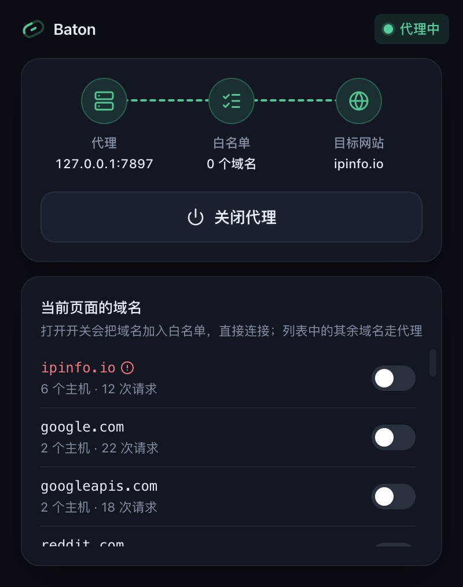

# Baton

Baton is a Chrome extension that sends browser traffic through a single proxy and lets you choose, domain by domain, what connects directly instead.

<p align="center">
  
</p>

```
Chrome ──► Baton ──► Proxy ──► Destination
             └─────────────► Destination   (whitelisted domains)
```

## Features

- Routes Chrome through one HTTP or SOCKS5 proxy, with optional authentication for HTTP proxies.
- Records every domain the current page requests and highlights domains whose requests failed.
- Adds a recorded domain to the whitelist with one switch, so it connects directly from then on.
- Matches whitelist entries against the domain and all of its subdomains, with `*` and `?` wildcards.
- Always connects directly to loopback and LAN addresses.
- Restores Chrome's own proxy setting when turned off.
- Follows the Chrome UI language (English or Simplified Chinese) and the system light or dark theme.

## Getting Started

1. Build the extension from source as described below.
2. Open `chrome://extensions`, turn on **Developer mode**, select **Load unpacked**, and choose the `dist/` folder.
3. Click the Baton icon in the toolbar, then select the **Proxy** node to set the proxy address.
4. Select **Turn On Proxy**.
5. Open a site. Switch on any domain under **Domains on This Page** to connect to it directly; select the **Whitelist** node to review or edit the full list.

## Whitelist Patterns

| Pattern         | Matches                                 |
| --------------- | --------------------------------------- |
| `example.com`   | `example.com` and all of its subdomains |
| `*.example.com` | Same as `example.com`                   |
| `*.cdn-*.net`   | Hosts matching the wildcard pattern     |

## Privacy

Settings and recorded domains stay in your browser, and recorded domains are cleared when Chrome closes. Baton makes no network requests of its own.

## Building from Source

Building requires Node.js 22 or later.

```sh
npm install
npm run build
```

The unpacked extension is written to `dist/`. Use `npm run dev` to rebuild on every change, then select **Reload** on the extension card in `chrome://extensions`.

| Script                 | Purpose                                                         |
| ---------------------- | --------------------------------------------------------------- |
| `npm run dev`          | Rebuild `dist/` on every change                                 |
| `npm run build`        | Type-check and build `dist/`                                    |
| `npm run typecheck`    | Type-check only                                                 |
| `npm run format`       | Format with dprint                                              |
| `npm run format:check` | Check formatting                                                |
| `npm run icons`        | Render `assets/icon.svg` to `public/icons/` with `rsvg-convert` |

## Limitations

- Chrome lets only one extension control the proxy at a time.
- Chrome does not support authentication for SOCKS proxies.

## License

Baton is released under the [MIT License](LICENSE).
